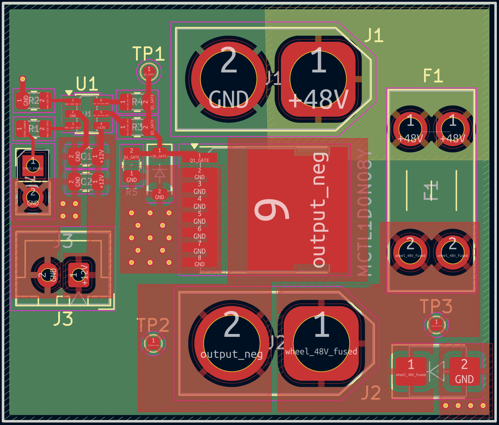
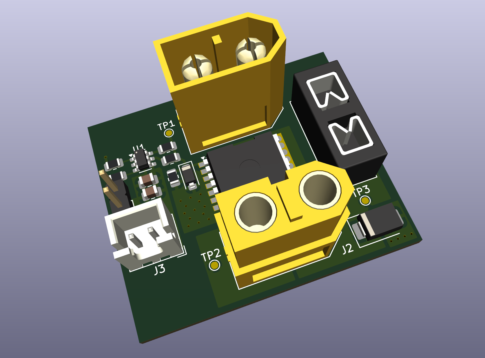
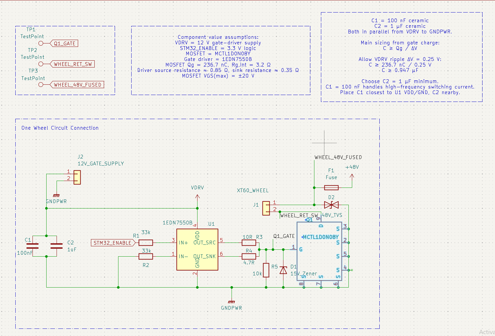
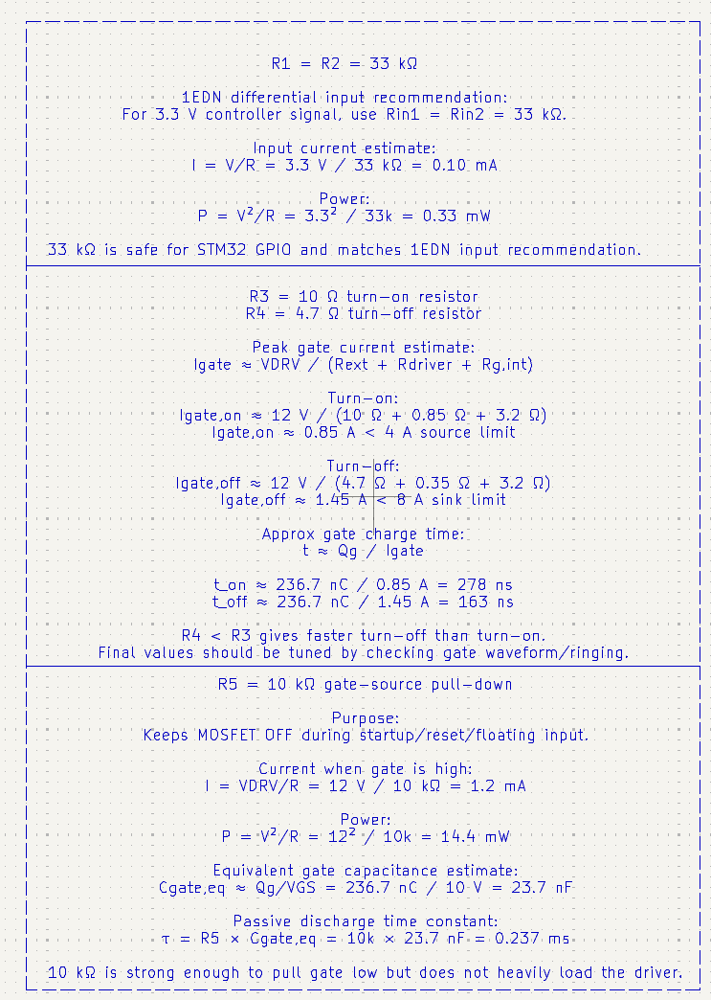
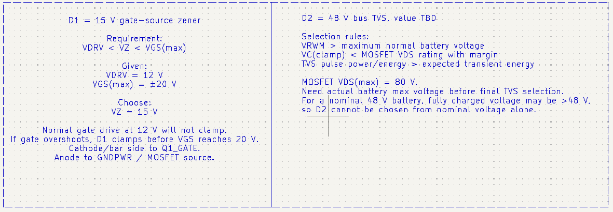

# 48 V Wheel Power Switch and Gate Driver

Work-in-progress KiCad design for switching the return path of a wheel module on a shared nominal 48 V bus. A 3.3 V STM32 enable signal controls an N-channel MOSFET through an Infineon 1EDN7550B gate driver powered by an assumed external regulated 12 V supply.

**Status: second PCB layout iteration (October 21, 2026). Work in progress — NOT the final version for fabrication.**

## Project milestone — second layout iteration

The team lead approved the schematic to proceed to layout on October 1, 2026. This update saves the second placement, routing and copper-zone iteration in `ProtectionGateDriver.kicad_pcb`, with the supplied project settings and libraries.

The scope is **one wheel per board**, with six separate one-wheel boards intended for the rover. Layout review, component-rating confirmation, current-path/thermal review and hardware validation remain outstanding. This upload is a development checkpoint, not a fabrication release. ERC/DRC were not independently rerun for this upload.

### Layout preview — iteration 2, not for fabrication

This iteration uses four copper layers (F.Cu, In1.Cu, In2.Cu and B.Cu), revised placement/routing, copper fills and ground vias. The uploaded native project files are preserved as supplied; this upload does not constitute an electrical design review.

The 3D image is a CAD preview, not a manufactured or tested board.

Previous checkpoint: [iteration 1 layout](images/layout-iteration-1.png) and [3D preview](images/layout-iteration-1-3d.png).

## Circuit overview

The description below refers to the synchronized editable KiCad files.

The intended load-current path is: J1 pin 1 (+48 V input) → fuse F1 → output_pos → J2 pin 1 → external wheel load → J2 pin 2 (output_neg) → Q1 drain → Q1 source → GND → J1 pin 2.

- Q1: MCC MCTL1D0N08Y, with custom symbol and adapted TOLL-8L footprint.
- U1: 1EDN7550B, with separate turn-on and turn-off gate resistors.
- Gate-source pulldown and Zener clamp; local driver-supply decoupling.
- J1: `48V_INPUT_XT_MALE`, with +48 V and GND input connections.
- J2: `WHEEL_OUTPUT_XT_FEMALE`, with `output_pos` and switched return `output_neg`.
- Driver supply: external regulated +12 V through J3; STM32 enable and GND through J4.
- D2 is connected between the fused positive supply and GND, after F1.
- Fuse and bus TVS are provisional and require selection against system requirements.

## Schematic preview — work in progress

Updated preview (October 9, 2026): supplied schematic showing input protection, wheel output, gate driver, test points and external supply/control connectors. Functional blocks connect through net labels. Layout refinement and hardware validation remain outstanding.

## Design calculations — preliminary

These are original working notes from the schematic, not measured results. **The corrections and limitations below take precedence over statements in the screenshots.**

### Input and gate-drive sizing

- **Arithmetic check:** `3.3² / 33,000 = 0.00033 W = 0.33 mW`, consistent with the image. The 0.10 mA figure assumes the full 3.3 V across one resistor; actual input current and resistor dissipation depend on the driver's differential input network and common-mode voltage.
- The approximately 0.85 A turn-on and 1.45 A turn-off figures are initial resistive estimates. Gate current varies during switching; `Qg / Ipeak` does not establish actual switching times. The listed 278 ns and 163 ns are rough estimates requiring waveform validation.
- `Qg / VGS` and the resulting 0.237 ms pulldown time constant are simplified approximations for a nonlinear gate. R5 discharges an undriven gate; it does not override a driver commanded high or alone guarantee safe behavior with floating control inputs.
- `236.7 nC / 0.25 V = 0.947 µF` is a first-order charge-balance estimate. Final decoupling must account for effective capacitance at 12 V, tolerance, ESR/ESL and layout; a nominal 1 µF capacitor does not guarantee that effective value.

### Gate clamp and bus protection

A nominal 15 V Zener does not by itself guarantee that gate voltage remains below 20 V. Verify its actual clamp voltage at the expected pulse current, tolerance and wiring inductance. TVS peak power (W) and pulse energy (J) must be checked separately against the transient waveform. Final fuse and TVS parts remain TBD.

## Open the project

Use KiCad 9. Open `ProtectionGateDriver.kicad_pro`, then the schematic. Keep the project files, library tables, symbol library and `ProtectionGateDriver.pretty` folder together. Both library tables use project-relative paths.

Q1 uses `ProtectionGateDriver:MCC_MCTL1D0N08Y_TOLL8L`: gate pad 1, source pads 2–8, drain pad 9. Source pads share connected copper. The footprint was adapted from KiCad's `Package_TO_SOT_SMD:Infineon_PG-HSOF-8-1`; inherited geometry and 3D model still need dimensional review. Upstream KiCad library licensing applies to derived library content; see https://www.kicad.org/libraries/license/.

## Repository baseline and completed milestones

- Received team-lead approval for the latest local schematic to proceed to PCB layout (status recorded October 1, 2026).
- Captured the low-side switching circuit and STM32 enable interface in the repository baseline.
- Synchronized the approved local schematic and project files; J1 is the 48 V input and J2 is the wheel output.
- Added a project-local MOSFET footprint with pad numbering matching the custom symbol.
- Checked edited schematic structure and connector wire paths programmatically. These checks do not replace KiCad ERC or hardware tests.

## Next steps — PCB layout and validation

- Review and refine the second PCB layout iteration; verify assigned footprints against the selected parts.
- Establish board dimensions, mounting requirements, connector positions and the intended stackup with the team.
- Place the MOSFET, gate driver, gate resistors and local decoupling to keep the gate-drive loop short; plan the load-current path and source-reference routing.
- Size copper and check clearances against confirmed electrical requirements and fabrication capabilities.

## Items to confirm and document before fabrication

Track these remaining implementation and validation items as layout proceeds.

- Confirm maximum bus voltage, wheel continuous/stall current, and whether the switched load is a motor or a motor controller.
- Select fuse and TVS ratings; assess the turn-off transient path and MOSFET voltage margin.
- Resolve the lead's AGND/DGND guidance and the system ground connection. The current schematic connects R2 to GND and J4 provides STM32 enable and GND; verify compatibility with the system grounding architecture.
- Verify MOSFET footprint dimensions against the manufacturer drawing.
- Complete remaining footprint assignments, KiCad ERC, PCB layout, thermal/current-path review and DRC.
- Define and carry out bench validation before claiming measured performance.

An RC snubber is not present in this revision. No simulation or measured performance is claimed.

## References

- [MCC MCTL1D0N08Y datasheet](https://www.mccsemi.com/pdf/Products/MCTL1D0N08Y(TOLL-8L).pdf)
- [Infineon 1EDN7550B datasheet](https://www.infineon.com/dgdl/Infineon-1EDN7550B-DS-v02_00-EN.pdf?fileId=5546d46262b31d2e01635d9799ef264f)
